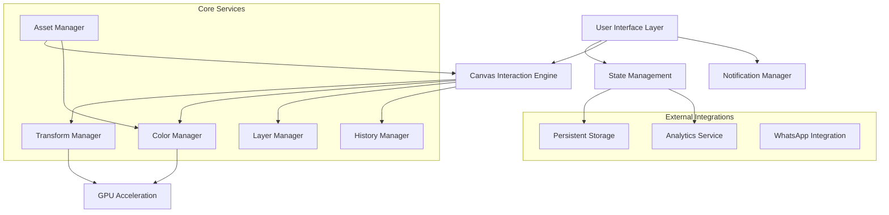

# Design Document

## Overview

This design document outlines the architecture and implementation approach for the photorealistic customize canvas feature. The system will replace the current vector-based t-shirt mockups with photorealistic images, implement advanced color selection with real-time fabric rendering, provide a mobile-optimized Photoshop-like interface, and include precise canvas interactions with comprehensive layer management.

The design leverages modern web technologies including Canvas API, CSS transforms, GPU acceleration, and responsive design patterns to deliver a professional-grade editing experience optimized for both desktop and mobile devices.

## Architecture

### High-Level System Architecture



### Component Architecture

The system follows a modular component architecture with clear separation of concerns:

1. **Presentation Layer**: React components for UI rendering
2. **Business Logic Layer**: Custom hooks and services for feature logic
3. **Data Layer**: State management and persistence
4. **Integration Layer**: External service integrations

## Components and Interfaces

### Core Components

#### 1. PhotorealisticCanvas Component

```typescript
interface PhotorealisticCanvasProps {
  selectedMockup: TshirtMockup;
  selectedColor: TshirtColor;
  designElements: DesignElement[];
  selectedElementId: string | null;
  canvasZoom: number;
  onElementSelect: (elementId: string | null) => void;
  onElementUpdate: (elementId: string, updates: Partial<DesignElement>) => void;
  onElementAdd: (element: DesignElement) => void;
  onElementDelete: (elementId: string) => void;
}

interface TshirtMockup {
  id: string;
  name: string;
  type: 'front' | 'back';
  variants: {
    '1x': string;
    '2x': string;
    '3x': string;
  };
  maskUrl: string;
  designArea: {
    x: number;
    y: number;
    width: number;
    height: number;
    curvature: BezierPath;
  };
}
```

#### 2. ColorRangeSelector Component

```typescript
interface ColorRangeSelectorProps {
  selectedColor: TshirtColor;
  onColorChange: (color: TshirtColor) => void;
  presetColors: TshirtColor[];
  textureFilters: TextureFilter[];
  onTextureChange: (filter: TextureFilter) => void;
}

interface TshirtColor {
  h: number; // 0-360
  s: number; // 0-100
  v: number; // 0-100
  r: number; // 0-255
  g: number; // 0-255
  b: number; // 0-255
