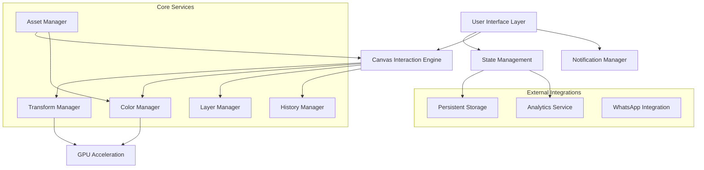

# Design Document

## Overview

This design document outlines the architecture and implementation approach for the photorealistic customize canvas feature. The system will replace the current vector-based t-shirt mockups with photorealistic images, implement advanced color selection with real-time fabric rendering, provide a mobile-optimized Photoshop-like interface, and include precise canvas interactions with comprehensive layer management.

The design leverages modern web technologies including Canvas API, CSS transforms, GPU acceleration, and responsive design patterns to deliver a professional-grade editing experience optimized for both desktop and mobile devices.

## Architecture

### High-Level System Architecture

### Component Architecture

The system follows a modular component architecture with clear separation of concerns:

1. **Presentation Layer**: React components for UI rendering
2. **Business Logic Layer**: Custom hooks and services for feature logic
3. **Data Layer**: State management and persistence
4. **Integration Layer**: External service integrations

