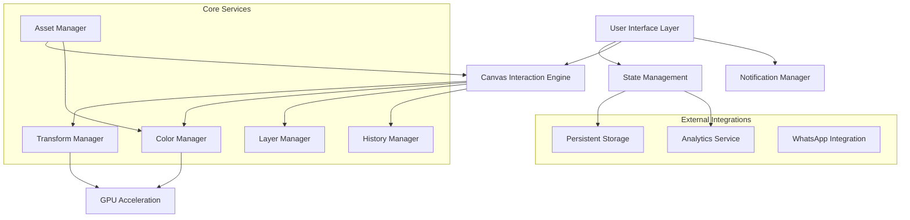

# Design Document

## Overview

This design document outlines the architecture and implementation approach for the photorealistic customize canvas feature. The system will replace the current vector-based t-shirt mockups with photorealistic images, implement advanced color selection with real-time fabric rendering, provide a mobile-optimized Photoshop-like interface, and include precise canvas interactions with comprehensive layer management.

The design leverages modern web technologies including Canvas API, CSS transforms, GPU acceleration, and responsive design patterns to deliver a professional-grade editing experience optimized for both desktop and mobile devices.

## Architecture

### High-Level System Architecture



### Component Architecture

The system follows a modular component architecture with clear separation of concerns:

1. **Presentation Layer**: React components for UI rendering
2. **Business Logic Layer**: Custom hooks and services for feature logic
3. **Data Layer**: State management and persistence
4. **Integration Layer**: External service integrations

## Components and Interfaces

### Core Components

#### 1. PhotorealisticCanvas Component

```typescript
interface PhotorealisticCanvasProps {
  selectedMockup: TshirtMockup;
  selectedColor: TshirtColor;
  designElements: DesignElement[];
  selectedElementId: string | null;
  canvasZoom: number;
  onElementSelect: (elementId: string | null) => void;
  onElementUpdate: (elementId: string, updates: Partial<DesignElement>) => void;
  onElementAdd: (element: DesignElement) => void;
  onElementDelete: (elementId: string) => void;
}

interface TshirtMockup {
  id: string;
  name: string;
  type: 'front' | 'back';
  variants: {
    '1x': string;
    '2x': string;
    '3x': string;
  };
  maskUrl: string;
  designArea: {
    x: number;
    y: number;
    width: number;
    height: number;
    curvature: BezierPath;
  };
}
```

#### 2. ColorRangeSelector Component

```typescript
interface ColorRangeSelectorProps {
  selectedColor: TshirtColor;
  onColorChange: (color: TshirtColor) => void;
  presetColors: TshirtColor[];
  textureFilters: TextureFilter[];
  onTextureChange: (filter: TextureFilter) => void;
}

interface TshirtColor {
  h: number; // 0-360
  s: number; // 0-100
  v: number; // 0-100
  r: number; // 0-255
  g: number; // 0-255
  b: number; // 0-255
  hex: string;
  name?: string;
}

interface TextureFilter {
  id: string;
  name: string;
  shader: string;
  preview: string;
}
```

#### 3. MobileEditingPanel Component

```typescript
interface MobileEditingPanelProps {
  isOpen: boolean;
  onToggle: () => void;
  selectedTool: EditingTool;
  onToolChange: (tool: EditingTool) => void;
  layers: DesignElement[];
  selectedElementId: string | null;
  onLayerSelect: (elementId: string) => void;
  onLayerReorder: (fromIndex: number, toIndex: number) => void;
  properties: ElementProperties;
  onPropertyChange: (property: string, value: any) => void;
}

type EditingTool = 'move' | 'crop' | 'text' | 'image' | 'mask' | 'pen' | 'eyedropper';
```

#### 4. TransformControls Component

```typescript
interface TransformControlsProps {
  element: DesignElement;
  isSelected: boolean;
  onTransform: (transform: TransformData) => void;
  onTransformEnd: () => void;
  canvasRect: DOMRect;
  zoom: number;
}

interface TransformData {
  x: number;
  y: number;
  width: number;
  height: number;
  rotation: number;
  scaleX: number;
  scaleY: number;
}
```

#### 5. WhatsAppNotification Component

```typescript
interface WhatsAppNotificationProps {
  isVisible: boolean;
  onDismiss: () => void;
  onWhatsAppClick: () => void;
  config: NotificationConfig;
}

interface NotificationConfig {
  phoneNumber: string;
  defaultMessage: string;
  cooldownMinutes: number;
  intervalMinutes: number;
  excludedPages: string[];
}
```

### Service Interfaces

#### 1. Transform Manager

```typescript
interface TransformManager {
  applyTransform(elementId: string, transform: TransformData): void;
  getTransformMatrix(element: DesignElement): DOMMatrix;
  snapToGuides(position: Point, threshold: number): Point;
  getSnapGuides(element: DesignElement, allElements: DesignElement[]): SnapGuide[];
  validateBounds(element: DesignElement, canvasBounds: Rect): DesignElement;
}

interface SnapGuide {
  type: 'center' | 'edge' | 'element' | 'grid';
  position: number;
  axis: 'x' | 'y';
  temporary: boolean;
}
```

#### 2. Color Manager

```typescript
interface ColorManager {
  applyColorToFabric(color: TshirtColor, mockup: TshirtMockup): Promise<string>;
  convertColorSpace(color: any, from: ColorSpace, to: ColorSpace): any;
  generateColorPreview(color: TshirtColor, texture: TextureFilter): string;
  blendColorWithFabric(color: TshirtColor, fabricBase: string): string;
}

type ColorSpace = 'rgb' | 'hsv' | 'hsl' | 'lab';
```

#### 3. Layer Manager

```typescript
interface LayerManager {
  addLayer(element: DesignElement): void;
  removeLayer(elementId: string): void;
  reorderLayer(elementId: string, newIndex: number): void;
  duplicateLayer(elementId: string): DesignElement;
  toggleLayerVisibility(elementId: string): void;
  lockLayer(elementId: string, locked: boolean): void;
  searchLayers(query: string): DesignElement[];
}
```

#### 4. History Manager

```typescript
interface HistoryManager {
  saveState(state: CanvasState): void;
  undo(): CanvasState | null;
  redo(): CanvasState | null;
  canUndo(): boolean;
  canRedo(): boolean;
  clearHistory(): void;
  getHistorySize(): number;
}

interface CanvasState {
  elements: DesignElement[];
  selectedElementId: string | null;
  canvasZoom: number;
  timestamp: number;
}
```

## Data Models

### Core Data Models

#### DesignElement Model

```typescript
interface DesignElement {
  id: string;
  type: 'text' | 'image' | 'shape' | 'sticker';
  name: string;
  
  // Position and Transform
  x: number;
  y: number;
  width: number;
  height: number;
  rotation: number;
  scaleX: number;
  scaleY: number;
  
  // Appearance
  opacity: number;
  visible: boolean;
  locked: boolean;
  blendMode: BlendMode;
  
  // Type-specific properties
  textProperties?: TextProperties;
  imageProperties?: ImageProperties;
  shapeProperties?: ShapeProperties;
  
  // Metadata
  createdAt: number;
  updatedAt: number;
  zIndex: number;
}

interface TextProperties {
  content: string;
  fontFamily: string;
  fontSize: number;
  fontWeight: number;
  fontStyle: 'normal' | 'italic';
  color: string;
  textAlign: 'left' | 'center' | 'right';
  lineHeight: number;
  letterSpacing: number;
  textShadow?: TextShadow;
}

interface ImageProperties {
  src: string;
  originalSrc: string;
  cropData?: CropData;
  filters: ImageFilter[];
  backgroundRemoved: boolean;
}

interface CropData {
  x: number;
  y: number;
  width: number;
  height: number;
  originalWidth: number;
  originalHeight: number;
}
```

#### Canvas State Model

```typescript
interface CanvasState {
  // T-shirt Configuration
  selectedMockup: TshirtMockup;
  selectedColor: TshirtColor;
  selectedTexture: TextureFilter;
  
  // Design Elements
  elements: DesignElement[];
  selectedElementId: string | null;
  
  // Canvas Settings
  canvasZoom: number;
  canvasPan: Point;
  showGrid: boolean;
  snapToGrid: boolean;
  gridSize: number;
  
  // UI State
  selectedTool: EditingTool;
  panelOpen: boolean;
  panelWidth: number;
  
  // History
  historyIndex: number;
  maxHistorySize: number;
}
```

### Notification State Model

```typescript
interface NotificationState {
  visible: boolean;
  lastShown: number;
  dismissed: boolean;
  dismissedUntil: number;
  showCount: number;
  clickCount: number;
  dismissCount: number;
}
```

## Error Handling

### Error Categories and Handling Strategies

#### 1. Asset Loading Errors

```typescript
interface AssetError extends Error {
  type: 'asset_load_failed';
  assetUrl: string;
  retryCount: number;
}

// Strategy: Retry with exponential backoff, fallback to lower resolution
const handleAssetError = async (error: AssetError): Promise<string> => {
  if (error.retryCount < 3) {
    await delay(Math.pow(2, error.retryCount) * 1000);
    return retryAssetLoad(error.assetUrl, error.retryCount + 1);
  }
  return getFallbackAsset(error.assetUrl);
};
```

#### 2. Canvas Operation Errors

```typescript
interface CanvasError extends Error {
  type: 'canvas_operation_failed';
  operation: string;
  elementId?: string;
}

// Strategy: Graceful degradation, user notification
const handleCanvasError = (error: CanvasError): void => {
  logError(error);
  showUserNotification(`Operation "${error.operation}" failed. Please try again.`);
  revertToLastValidState();
};
```

#### 3. Performance Errors

```typescript
interface PerformanceError extends Error {
  type: 'performance_threshold_exceeded';
  operation: string;
  duration: number;
  threshold: number;
}

// Strategy: Optimize operation, reduce quality if necessary
const handlePerformanceError = (error: PerformanceError): void => {
  if (error.operation === 'color_blend') {
    enableLowQualityMode();
  }
  schedulePerformanceOptimization();
};
```

### Error Recovery Mechanisms

1. **State Recovery**: Automatic reversion to last known good state
2. **Asset Fallbacks**: Progressive quality degradation for failed assets
3. **Operation Queuing**: Retry failed operations with backoff
4. **User Feedback**: Clear error messages with suggested actions

## Testing Strategy

### Unit Testing

#### Component Testing
- **PhotorealisticCanvas**: Render testing, interaction handling, prop validation
- **ColorRangeSelector**: Color conversion accuracy, UI interactions
- **TransformControls**: Transform calculations, boundary validation
- **MobileEditingPanel**: Panel state management, tool switching

#### Service Testing
- **TransformManager**: Matrix calculations, snap detection, bounds validation
- **ColorManager**: Color space conversions, fabric blending algorithms
- **LayerManager**: Layer operations, search functionality
- **HistoryManager**: State persistence, undo/redo operations

### Integration Testing

#### Canvas Integration Tests
```typescript
describe('Canvas Integration', () => {
  test('element selection updates transform controls', async () => {
    const canvas = render(<PhotorealisticCanvas {...props} />);
    const element = await canvas.findByTestId('design-element-1');
    
    fireEvent.click(element);
    
    expect(canvas.getByTestId('transform-controls')).toBeVisible();
    expect(canvas.getByTestId('properties-panel')).toHaveTextContent('Element 1');
  });
  
  test('color changes update fabric appearance', async () => {
    const canvas = render(<PhotorealisticCanvas {...props} />);
    const colorPicker = canvas.getByTestId('color-picker');
    
    fireEvent.change(colorPicker, { target: { value: '#ff0000' } });
    
    await waitFor(() => {
      expect(canvas.getByTestId('tshirt-mockup')).toHaveStyle({
        filter: expect.stringContaining('hue-rotate')
      });
    });
  });
});
```

#### Mobile Panel Tests
```typescript
describe('Mobile Panel Integration', () => {
  test('panel expansion adjusts canvas size', () => {
    const { container } = render(<CustomizeCanvas isMobile={true} />);
    const panelToggle = container.querySelector('[data-testid="panel-toggle"]');
    
    fireEvent.click(panelToggle);
    
    expect(container.querySelector('[data-testid="canvas-area"]')).toHaveStyle({
      width: 'calc(100% - 260px)'
    });
  });
});
```

### Performance Testing

#### Canvas Performance Tests
```typescript
describe('Canvas Performance', () => {
  test('transform operations complete within 60ms', async () => {
    const startTime = performance.now();
    
    await transformElement('element-1', { x: 100, y: 100, rotation: 45 });
    
    const duration = performance.now() - startTime;
    expect(duration).toBeLessThan(60);
  });
  
  test('color blending maintains 60fps', async () => {
    const frameRates = [];
    const observer = new PerformanceObserver((list) => {
      frameRates.push(...list.getEntries().map(e => 1000 / e.duration));
    });
    
    observer.observe({ entryTypes: ['frame'] });
    
    await changeColor('#ff0000');
    
    const avgFrameRate = frameRates.reduce((a, b) => a + b) / frameRates.length;
    expect(avgFrameRate).toBeGreaterThan(55); // Allow 5fps tolerance
  });
});
```

### Accessibility Testing

#### Keyboard Navigation Tests
```typescript
describe('Accessibility', () => {
  test('all interactive elements are keyboard accessible', () => {
    const { container } = render(<CustomizeCanvas />);
    const interactiveElements = container.querySelectorAll('button, input, [tabindex]');
    
    interactiveElements.forEach(element => {
      expect(element).toHaveAttribute('tabindex');
      expect(element).toHaveAttribute('aria-label');
    });
  });
  
  test('canvas elements can be navigated with arrow keys', () => {
    const canvas = render(<PhotorealisticCanvas {...props} />);
    const element = canvas.getByTestId('design-element-1');
    
    element.focus();
    fireEvent.keyDown(element, { key: 'ArrowRight' });
    
    expect(element).toHaveStyle({ transform: 'translate(1px, 0px)' });
  });
});
```

### End-to-End Testing

#### User Workflow Tests
```typescript
describe('Complete User Workflows', () => {
  test('user can create, customize, and export design', async () => {
    // 1. Load canvas
    const page = await browser.newPage();
    await page.goto('/customize');
    
