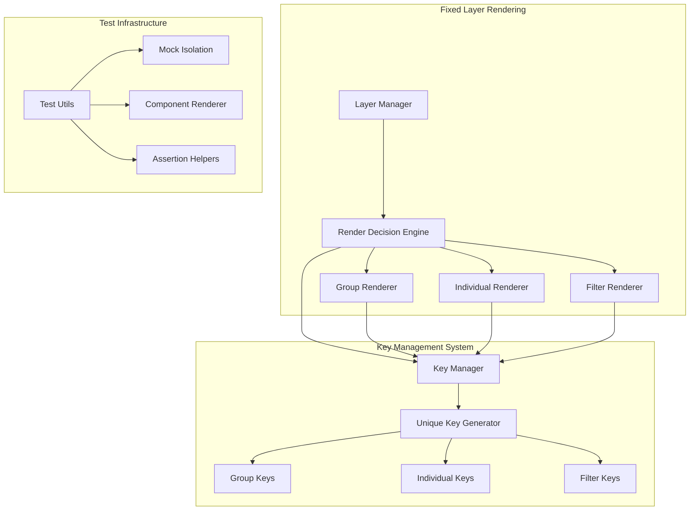

# Design Document

## Overview

This design document outlines the approach to fix duplicate element rendering issues in the layer management system of the photorealistic customize canvas. The primary issues stem from improper component key management, incorrect conditional rendering logic, and test setup problems that cause elements to be rendered multiple times in both grouped and individual contexts.

The solution focuses on implementing proper React key management, fixing conditional rendering logic, updating test utilities, and ensuring consistent component behavior across different rendering scenarios.

## Architecture

### Problem Analysis

The duplicate rendering issues occur in several scenarios:

1. **Layer Groups**: Elements appear both in group containers and as individual items
2. **Search/Filter Results**: Filtered elements show duplicates due to key conflicts
3. **Test Environment**: Test utilities don't properly isolate component instances
4. **State Management**: Inconsistent state updates cause multiple renders

### Solution Architecture

## Components and Interfaces

### Core Component Fixes

#### 1. LayersPanel Component Redesign

The main issue is in the rendering logic where layers appear both in groups and individually. The fix involves proper filtering and unique key generation.

#### 2. LayerGroup Component Fix

Groups need to properly manage their child layers and ensure no duplication with individual rendering.

#### 3. Enhanced Key Management System

A centralized key management system ensures unique keys across all rendering contexts.

### Test Infrastructure Improvements

#### 1. Enhanced Test Utilities

Fixed test utilities that properly isolate component instances and provide consistent mock data.

#### 2. Assertion Helpers

Specialized assertion functions to detect and prevent duplicate rendering in tests.

## Data Models

### Enhanced Layer Group Model

Improved data structures to support proper rendering decisions and prevent conflicts.

### Render Decision Engine

A system to determine when and how layers should be rendered based on their context.

## Error Handling

### Duplicate Detection and Prevention

Development-time detection system to catch duplicate rendering issues early.

## Testing Strategy

### Unit Tests for Fixed Components

Comprehensive tests to ensure no duplicate rendering occurs in any scenario.

### Integration Tests

Tests that verify the complete layer management system works without duplicates.

### Performance Tests

Ensure the fixes don't impact rendering performance negatively.

This design provides a comprehensive solution to the duplicate rendering issues by implementing proper key management, fixing conditional rendering logic, and providing robust test utilities to prevent regression.